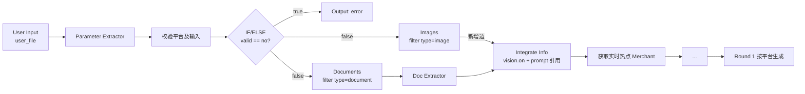

# 图片支路修复说明（WK8 多平台文案工作流）

> 原始文件 `WK8_multi-platform_content_generator_Human_Tone_Review_Trends.yaml` 未做任何修改（符合 共识.md）。
> 修复后的文件：`WK8_multi-platform_content_generator_Human_Tone_Review_Trends_v2.yaml`（可直接导入 Dify）。

## 一、断在哪里

| 检查项 | 原文件实际状态 |
| --- | --- |
| `Images`（list-operator，id `1783054784082`） | 只有入边 `IF/ELSE false → Images`，**出度为 0**，链到它后面就断了 |
| 谁消费图片 | 没有任何节点引用 `1783054784082.result`，图片被筛选出来后无人使用 |
| `Integrate Info`（llm，id `1783054905331`） | `vision.enabled: false`；user prompt 只引用 Draft 与 Doc Extractor 文本 |
| 文档支路对比 | `Documents → Doc Extractor → Integrate Info` 是通的，唯独图片支路悬空 |

即：上传图片 → IF/ELSE 校验通过 → `Images` 过滤出 `type=image` 的文件 → **无下游**。
文字/文档能进模型，图片永远进不去，属于「节点断了，缺一段」。

另一个旁证：`Integrate Info` 的 system prompt 里本来就写了
`Image input, if any, is not evidence of a price or credential`——说明设计上这个节点就要吃图片，
只是连线和视觉开关漏了。

## 二、改了什么（只有 2 处 diff，共 3 项）

1. **补边**：`Images` → `Integrate Info`
   `v2.yaml:393-403`
   ```yaml
   - id: 1783054784082-source-1783054905331
     source: '1783054784082'
     sourceHandle: source
     target: '1783054905331'
     targetHandle: target
     data: {sourceType: list-operator, targetType: llm}
   ```
2. **给 Integrate Info 开视觉**，指向 Images 的结果：`v2.yaml:973-979`
   ```yaml
   vision:
     configs:
       detail: high
       variable_selector: ['1783054784082', 'result']
     enabled: true
   ```
3. **prompt 增加图片引用**：`v2.yaml:962-968`
   ```
   Reference images: Images{{#1783054784082.result#}}
   ```

三处是配套的：只补边不开视觉 → 图片不会被送进模型；只开视觉不补边 → 节点根本不会被执行。
（`vision.configs` 的写法与 Dify 官方 DSL 一致，见文末参考实现。）

## 三、修复后的链路



`Integrate Info` 现在有两个前驱（Doc Extractor、Images），Dify 会等两者都完成再执行：
只传图片时文档侧为空文本，只传文档/纯文字时图片数组为空，都不会阻塞后续流程。

## 四、我做的校验（离线，未连 Dify）

- YAML 解析通过；节点 34 / 连边 37 → 38，节点 id 与位置未改动。
- 全部连边的 `source`/`target` 存在，且 `sourceType`/`targetType` 与真实节点类型一致，错误 0 条。
- 全文件 `{{#node.var#}}` 引用均指向存在的节点（唯一例外 `env.TREND_API_URL`，是环境变量，正常）。
- 编码保持 UTF-8 无 BOM、CRLF 行尾，与原件一致；diff 仅 2 个 hunk。
- 说明：`Create Content` 在迭代内没有出边、`iteration-start` 没有入边，属 Dify 迭代节点的正常导出形态
  （迭代用 `output_selector` 回收结果），不是断点。

## 五、导入后请跑这 3 个用例

1. **只传 1~2 张图片**（如海报/门店照）+ 简短 draft → 确认 Integrate Info 输出里体现图片内容，
   且不把图片里的数字/资质当事实（system prompt 已约束）。
2. **只传 PDF/Word、不传图片** → 确认不因空图片数组报错，走原文档支路。
3. **纯文字、不传文件** → 确认与修复前行为一致。

## 六、需要你确认的一点（我无法离线验证）

`Integrate Info` 当前模型是 `z-ai/glm-5.3-flash`（OpenRouter）。若该模型**不支持图像输入**，
用例 1 会报视觉相关错误。两种收尾方式：

- **换模型**：把 Integrate Info 换成支持视觉的模型即可（推荐，改动最小，其余不动）。
- **加一层解耦**：`Images → 图片转文字(vision LLM) → Integrate Info(纯文本)`，
  这样 Integrate Info 可继续用任意纯文本模型；代价是多一次调用、多一个节点。

需要的话我可以直接出第二种版本的 YAML。

## 七、未改动但值得知道的

- `features.file_upload.enabled` 仍是 `false`：该开关管聊天附件，start 节点的 `file-list` 变量自带上传控件，
  参考实现里同样是 `false` 也能正常上传，所以没动。若你的前端上传按钮被隐藏，改成：
  `enabled: true`、`allowed_file_types: [image, document]`、`number_limits: 10`（与 start 节点 `max_length: 10` 对齐）。
- `Images` 节点的 `limit` 未启用，`user_file` 上限由 start 节点 `max_length: 10` 控制；如需限制图片张数可在该节点开 `limit`。
- 文件未提交 git；需要我提交一个 commit 说一声。

参考实现（Dify 官方 DSL 中的视觉写法与「图片 + 文档并行提取」范式）：
[Dify 文件通用提取文字工作流分享](https://cloud.tencent.com/developer/article/2614726)